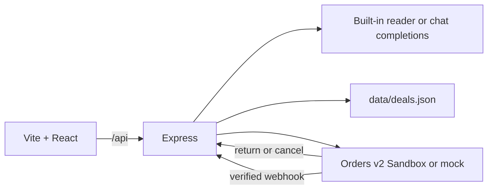
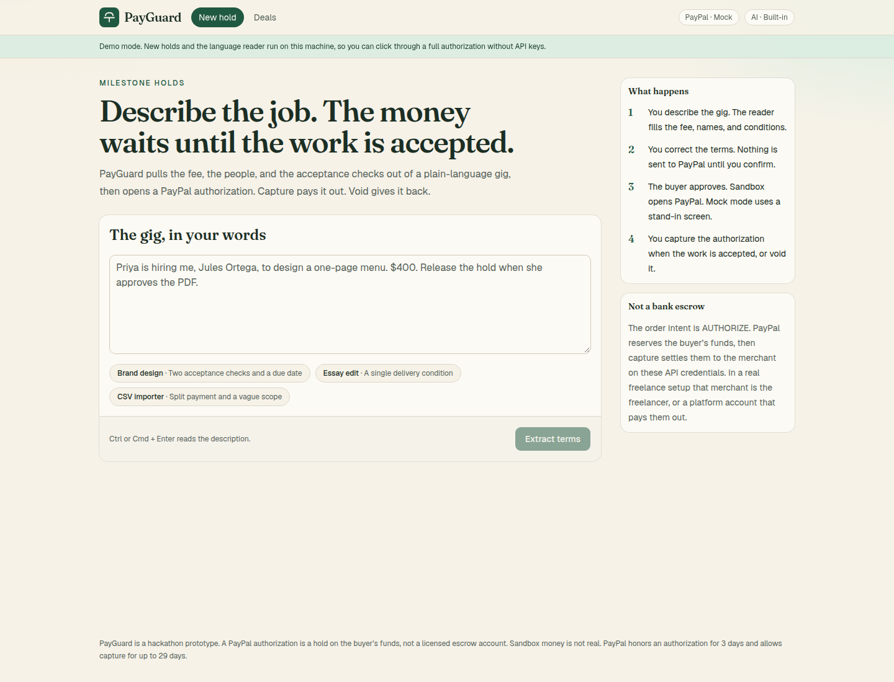
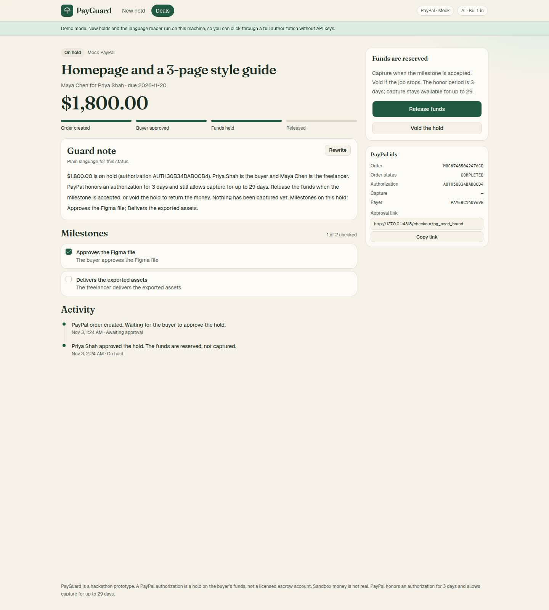
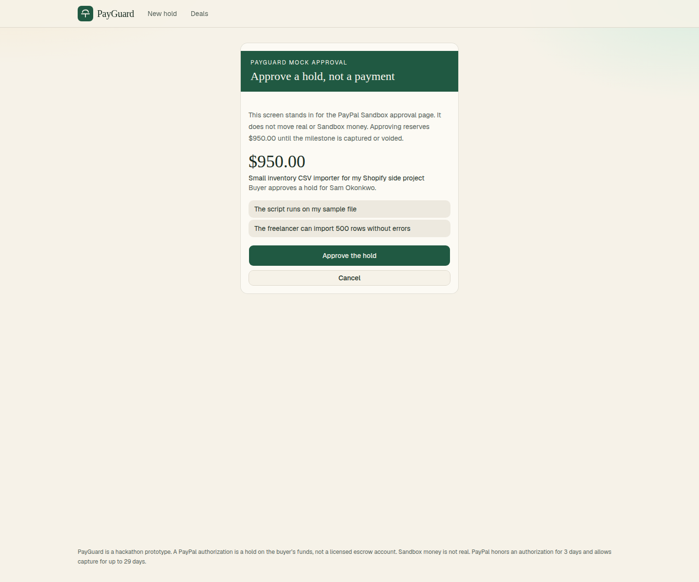
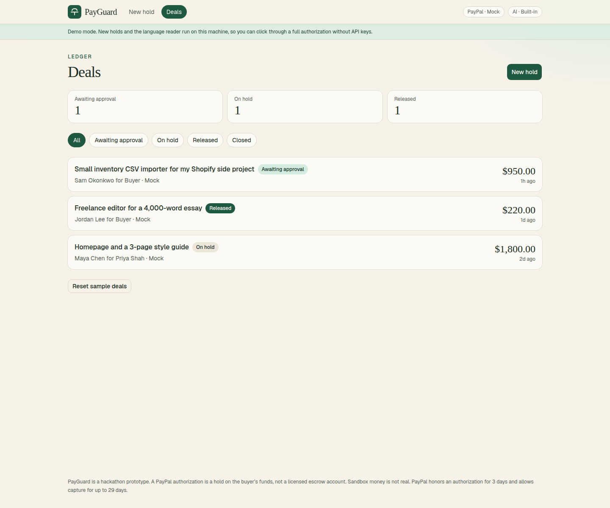

# PayGuard

PayGuard is an AI milestone assistant for freelance work. You describe a gig in plain language. PayGuard extracts the fee, the people, the acceptance conditions, and the risks, then opens a **PayPal authorization hold**. The buyer approves it. Funds stay reserved until you capture (release) or void (give back).

It is a hackathon prototype for the [PayPal AI Hackathon](https://paypalaihackathon.devpost.com/) (deadline Nov 12, 2026, 12:00 PST). A PayPal authorization is not a licensed escrow account. Sandbox money is not real.

PayPal honors an authorization for **3 days** and still allows capture for up to **29 days**. `AUTHORIZE` supports a single purchase unit, so each deal is one hold and one capture, even when the gig lists several conditions.

## Release gate

The model does not capture or void.

It drafts terms from the gig description: fee, names, due date, milestones, and risks. A person can edit every field. Nothing is sent to PayPal until they press **Create authorization hold**. The buyer approves the order on PayPal Sandbox, or on the mock screen. Funds stay reserved until a person presses **Release funds** or **Void the hold**.

Unchecked milestones show a warning in that dialog. They do not block release. There is no pass/fail score, and no model output calls capture or void. **Rewrite** only replaces the plain-language status sentence.

PayGuard is not a licensed escrow. A PayPal authorization holds the buyer's funds, then a later capture settles them to the merchant on this app's API credentials.

## Quick start

Requires Node.js 22 or newer.

```bash
npm install
npm run dev
```

Open [http://127.0.0.1:4318](http://127.0.0.1:4318).

No keys are required. With `PAYPAL_CLIENT_ID`, `PAYPAL_CLIENT_SECRET`, and `OPENAI_API_KEY` unset, the app runs in **mock mode**:

- A built-in reader extracts terms (no model call).
- “Approval” is a PayGuard screen that stands in for PayPal Sandbox.
- Capture, void, cancel, webhooks, and the ledger all work on local data in `data/deals.json`.

```bash
npm test
```

## Sandbox setup

1. Create a [PayPal developer account](https://developer.paypal.com/dashboard/).
2. Open **Apps & Credentials → Sandbox** and create a REST app. Copy the **Client ID** and **Secret**.
3. Under **Sandbox → Accounts**, note the **business** account (the API caller, the merchant that receives a capture) and a **personal** account (the buyer who approves).
4. Copy `.env.example` to `.env` and set:

```bash
PAYPAL_CLIENT_ID=your_sandbox_client_id
PAYPAL_CLIENT_SECRET=your_sandbox_secret
PAYGUARD_PAYPAL=auto
PUBLIC_BASE_URL=http://127.0.0.1:4317
CLIENT_ORIGIN=http://127.0.0.1:4318
```

5. Restart `npm run dev`. The header pill should say **PayPal · Sandbox**.
6. Create a hold. **Approve on PayPal Sandbox** opens `sandbox.paypal.com`. Sign in as the **personal** sandbox buyer. PayPal’s button may say Pay. The order intent is `AUTHORIZE`, so approval reserves the funds instead of capturing them.
7. PayPal redirects to `PUBLIC_BASE_URL/api/paypal/return`, which calls `POST /v2/checkout/orders/{id}/authorize`, then sends the browser back to the deal.
8. **Release funds** calls `POST /v2/payments/authorizations/{id}/capture`. **Void the hold** calls `POST /v2/payments/authorizations/{id}/void`. Those calls happen only from those actions.
9. To let PayPal update a deal by webhook, set `PAYPAL_WEBHOOK_ID` to that Sandbox webhook's id. Until it is set, `POST /api/paypal/webhook` refuses the body and leaves the deal unchanged. The return URL, **Release funds**, and **Void the hold** do not depend on it.

`PUBLIC_BASE_URL` must be the API origin (`4317` in dev), because that is the host PayPal redirects to. The Vite app on `4318` proxies `/api` to it.

### Webhook verification

`POST /api/paypal/webhook` can record these events when `custom_id`, the order id, or the authorization id matches a deal:

- `CHECKOUT.ORDER.APPROVED` (authorizes if the buyer never returned)
- `PAYMENT.AUTHORIZATION.CREATED`
- `PAYMENT.CAPTURE.COMPLETED`
- `PAYMENT.AUTHORIZATION.VOIDED`

Sandbox mode does not apply an event unless PayPal verifies it. `GET /api/health` reports `webhookVerification: true` only when PayPal mode is sandbox and `PAYPAL_WEBHOOK_ID` is set.

| PayPal mode | `PAYPAL_WEBHOOK_ID` | Signature | What the route does |
| --- | --- | --- | --- |
| sandbox | unset | missing or present | **Fail closed.** HTTP 503. The deal is not changed. PayPal is not asked to verify the body. |
| sandbox | set | missing headers, a non-https certificate URL, a host outside `paypal.com`, or any verify result other than `SUCCESS` | **Fail closed.** HTTP 401. The deal is not changed. |
| sandbox | set | PayPal `verification_status` is `SUCCESS` | The event is applied. The response says `verified: "verified"`. |
| mock | ignored | none | Local stand-in for `npm test` and curl. The response says `verified: "skipped"`. It does not call PayPal. Do not point a PayPal webhook at a mock-mode server. |

Verification posts the headers and event to `/v1/notifications/verify-webhook-signature` with the app's Sandbox credentials. A certificate URL is sent there only when it is `https` and its host is `paypal.com` or a subdomain of it. If that call errors, the route returns HTTP 500 and does not change the deal.

A verified capture or void event updates the local deal so it matches PayPal. It does not call PayPal's capture or void APIs. Those API calls happen only when a person uses **Release funds** or **Void the hold**. `CHECKOUT.ORDER.APPROVED`, once verified, can call PayPal authorize if the buyer never hit the return URL.

Repeating a verified event does not capture or void twice. The deal moves from `created` or `approved` to `authorized`, and from `authorized` to `captured` or `voided`. There is no separate transmission-id ledger.

This check is the PayPal webhook boundary. The demo routes that list deals and release or void a hold have no user accounts. A public Sandbox demo is not an authorization system for a live merchant.

Point a Sandbox webhook at `PUBLIC_BASE_URL/api/paypal/webhook` only after `PAYPAL_WEBHOOK_ID` is set. The return URL alone is enough for the happy path.

## AI setup

Any OpenAI-compatible `POST /chat/completions` endpoint works (OpenAI, Vultr Inference, Otari, and others).

```bash
OPENAI_BASE_URL=https://api.openai.com/v1
OPENAI_API_KEY=your_key
OPENAI_MODEL=gpt-4o-mini
PAYGUARD_AI=auto
```

`OPENAI_BASE_URL` should include `/v1` when the provider uses that prefix. The app asks for JSON terms, and retries once without `response_format` if the provider returns HTTP 400. If the model is missing, slow, or unusable, PayGuard falls back to the built-in reader and labels the result `mock-fallback`.

`PAYGUARD_AI=mock` forces the built-in reader even when a key is present. `PAYGUARD_PAYPAL=mock` forces the stand-in checkout the same way.

The model is used twice:

1. Turning the gig description into amount, currency, names, due date, milestones, and risk notes.
2. Rewriting the status explanation when you press **Rewrite** on a deal. The stored explanation is always grounded in the deal record.

## How judges can test

Mock path, about two minutes, no accounts:

1. `npm install && npm run dev`, open http://127.0.0.1:4318.
2. Click **Brand design** (or paste your own gig) and **Extract terms**.
3. Check the fee, the two conditions, and the revision risk. Change anything that is wrong.
4. **Create authorization hold**.
5. **Open mock approval**, then **Approve the hold**. The deal should say the money is on hold and mention the 3-day honor period and 29-day capture window.
6. Check a milestone and **Release funds**.
7. Open **Deals**. **Load sample deals** shows one hold waiting, one on hold, and one released.

Sandbox path: follow [Sandbox setup](#sandbox-setup), repeat steps 2–6, and approve with a sandbox personal account. The deal’s PayPal order id, authorization id, and capture id are on the deal page.

`npm test` covers extraction, the mock happy path, void, cancel, the return URL, a mock webhook, and Sandbox webhook cases for a missing webhook id, an invalid signature, and a verified signature. The Sandbox client records the `AUTHORIZE` request against a fake PayPal. No network calls leave the machine.

## Architecture



| Piece | Role |
| --- | --- |
| `client/` | React UI. Compose a gig, confirm terms, ledger, deal, mock approval. |
| `server/src/ai/mockExtract.ts` | Deterministic reader used when no model key is set, and as the fallback. |
| `server/src/ai/openai.ts` | OpenAI-compatible extract and status rewrite. |
| `server/src/paypal/sandbox.ts` | OAuth2, create order (`intent: AUTHORIZE`), authorize, capture, void, webhook verify. |
| `server/src/paypal/mock.ts` | Same steps with local ids and an in-app approval URL. |
| `server/src/deals.ts` | State machine: created → authorized → captured, or voided / cancelled / failed. |
| `data/deals.json` | Created at runtime. Gitignored. |

Approval links are chosen from HATEOAS `payer-action`, then `approve`. Return and cancel URLs live in `payment_source.paypal.experience_context` (not the deprecated `application_context`). Shipping is `NO_SHIPPING` because this is a service, not a parcel.

Each deal remembers whether it was created in mock or Sandbox, so sample deals stay simulated even after you add live keys.

### HTTP

| Method | Path | Purpose |
| --- | --- | --- |
| GET | `/api/health` | Mode flags. No secrets. |
| GET | `/api/samples` | Example gigs. |
| POST | `/api/extract` | Read a description. Does not create an order. |
| POST | `/api/deals` | Confirm terms and create the order. |
| GET | `/api/deals` | Ledger. |
| GET | `/api/deals/:id` | One deal. |
| POST | `/api/deals/:id/approve` | Mock buyer approval, then authorize. |
| POST | `/api/deals/:id/capture` | Capture the authorization. |
| POST | `/api/deals/:id/void` | Void the authorization. |
| POST | `/api/deals/:id/cancel` | Buyer left before approving. |
| POST | `/api/deals/:id/order` | Retry a failed create. |
| POST | `/api/deals/:id/explain` | Rewrite the plain-language status. |
| POST | `/api/deals/:id/milestones/:milestoneId` | Check a condition on or off. |
| GET | `/api/paypal/return` | PayPal return URL. Authorizes, then redirects to the UI. |
| GET | `/api/paypal/cancel` | PayPal cancel URL. |
| POST | `/api/paypal/webhook` | Sandbox: verified events only. Mock: local stand-in. |
| POST | `/api/demo/seed` | Upsert three sample deals. |

## Scripts

| Script | What it does |
| --- | --- |
| `npm run dev` | API on port 4317 and Vite on port 4318. |
| `npm test` | Server unit and API tests. |
| `npm run build` | Typecheck and build the client. |
| `npm start` | Serve the built UI and the API together on port 4317 (`SERVE_STATIC=1`). |

For the single-port server, set `CLIENT_ORIGIN` and `PUBLIC_BASE_URL` to the same origin so mock approval links and PayPal return URLs match.

## Screenshots









## Suggested demo video

Keep it under three minutes.

1. One sentence: freelancers get stuck when “I’ll pay you when it’s done” is not written down, and the money is not reserved.
2. Paste the brand-design sample. Show the extracted $1,800, both conditions, and the revision risk. Edit one field.
3. Create the hold. In mock mode, approve it and point at the sentence that says nothing has been captured yet.
4. If you have Sandbox keys, cut to the real PayPal approval and the return to PayGuard.
5. Check the milestones and release. End on the ledger.

## Devpost notes

You can submit early for the eligibility pre-check and edit the project until the deadline. A working repo with this README satisfies the “judges can run it” option. Also publish a public demo video under three minutes.

Suggested tools line: PayPal Orders v2 Sandbox (`AUTHORIZE`, then a person captures or voids) and an OpenAI-compatible chat model that drafts terms, with a built-in reader when no model key is configured. The model does not decide release. See [Release gate](#release-gate).

Do not commit `.env`. Secrets stay in the environment.

## License

[MIT](LICENSE)
